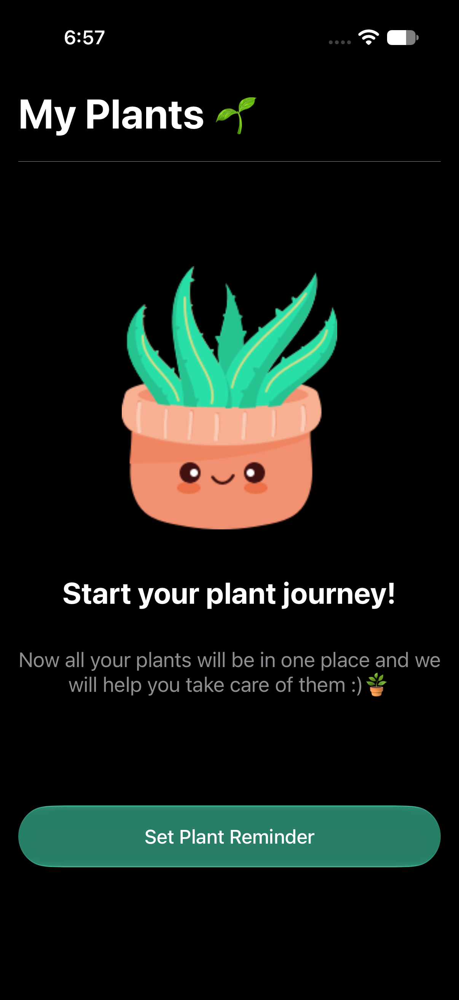
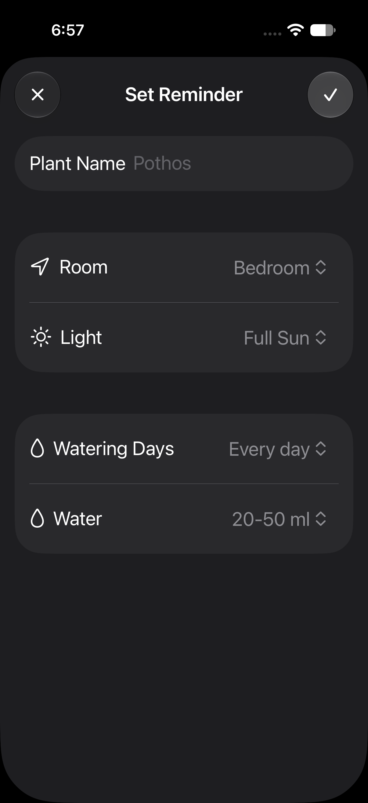
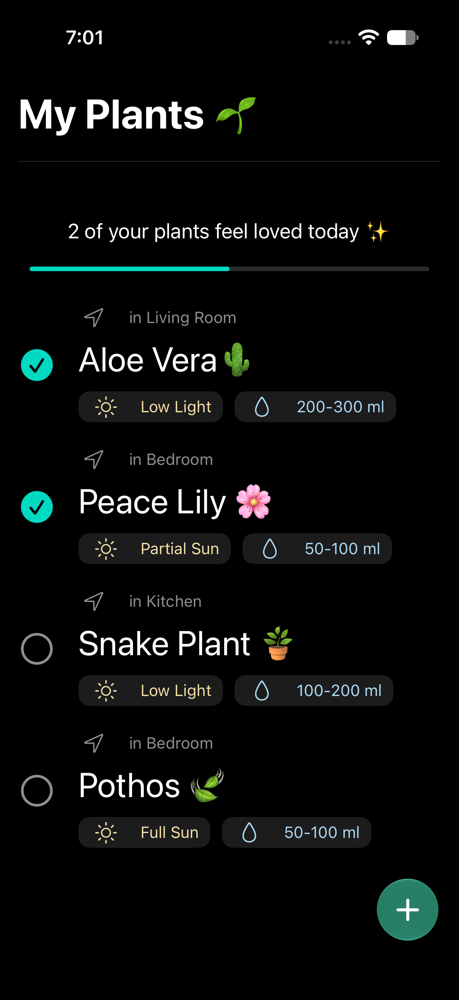
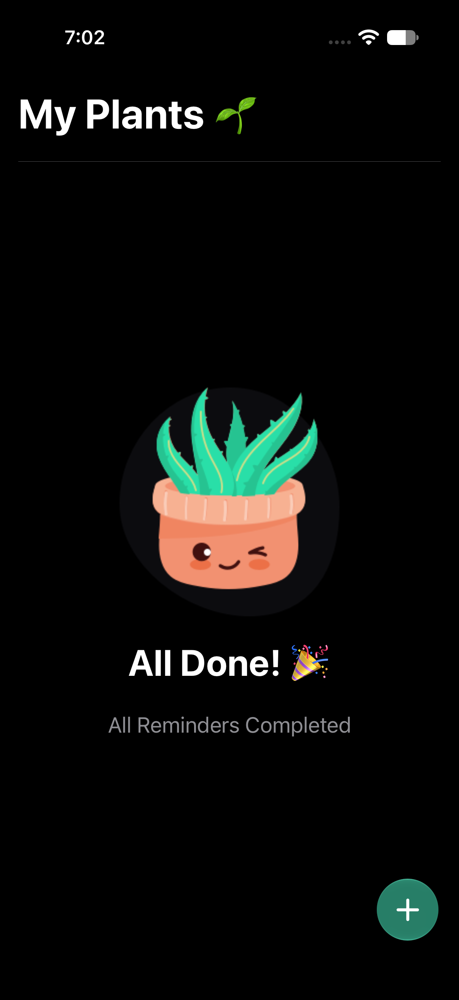

# 🌱 Planto

Planto is a plant care reminder app that helps users organize their plants, track watering progress, and remember when to water them.

## Main Features

- Add plants with their name, room, light conditions, watering frequency, and water amount.
- Edit and delete plant reminders.
- Mark plants as watered.
- Track watering progress with a progress bar.
- Schedule watering notifications.
- Save plant information locally.

## Technologies Used

- Swift
- SwiftUI
- MVVM Architecture
- UserDefaults
- UserNotifications
- Liquid Glass

## Screenshots

| Start Screen | Set Reminder |
|---|---|
|  |  |

| My Plants | All Done |
|---|---|
|  |  |
  
